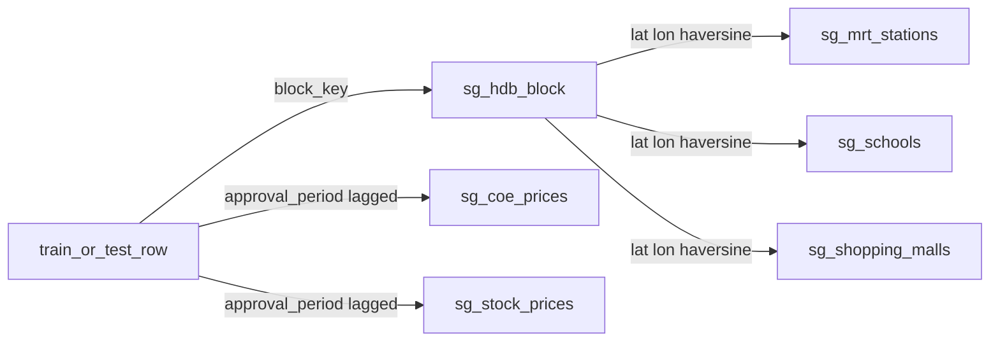

# 辅助数据新特征说明

本文定义可以从辅助表和主表现有字段构造、且当前不在 `train.csv` / `test.csv` 列里的新特征。后续实现按本节的列名、过滤条件和公式直接加列。

English notes, grouped the same way as the feature modules, are in [auxiliary_features/README.md](auxiliary_features/README.md).

本文不训练模型，也不用特征和 `MONTHLY_RENT` 的相关性来筛选列。优先级来自数据质量和机制判断，不是实验结果。除第 5.32 节的六个组内平均租金外，`MONTHLY_RENT` 不参与计算。

本地数据路径：

- `Data/train.csv`：150,000 行
- `Data/test.csv`：50,000 行
- `Data/auxiliary/sg-hdb-block.csv`：9,464 行
- `Data/auxiliary/sg-mrt-stations.csv`：243 行
- `Data/auxiliary/sg-schools.csv`：337 行
- `Data/auxiliary/sg-shopping-malls.csv`：113 行
- `Data/auxiliary/sg-coe-prices.csv`：539 行
- `Data/auxiliary/sg-stock-prices.csv`：91,642 行

计数来自当前本地 CSV。实现时用同一批文件复算第 3 节的断言，再生成第 4 节的列。

---

## 1. 对构造思路的修正

下面是落地时采用的规则。

1. 地铁按线路取最近站，只对六条干线各做两列：`NS`、`EW`、`NE`、`CC`、`DT`、`TE`。`CG` 是东西线的机场支线，并入 `EW`，不单独成列。`BP`、`PE`、`PTC`、`RTS`、`STC`、`DE` 只有 1–2 个站，不单独成列。`CR`、`JE`、`JS`、`JW`、`CP` 放到“未来线路”距离里，不进入“最近已开通地铁”。
2. 学校和商场不做“每条线路一个最近点”。学校按学段过滤：小学、中学、全部学校。商场只做最近距离和半径内个数。
3. 区域使用楼栋表已有的 `SUBZONE`、`PLANNING_AREA`、`REGION`。密度用 500 米内其他楼栋数、到本镇楼栋质心的距离、到莱佛士坊固定坐标的距离。不做 k-means 簇编号。
4. `MAX_FLOOR` 是整栋最高层，不是出租单位所在楼层。`MAX_FLOOR = -1` 与 `YEAR_COMPLETED = -1` 是同一批 11 栋楼的哨兵值，输出为缺失，不当作真实楼层或年份。
5. COE 是拥车证投标价，用作按月对齐的市场流动性代理。价格字符串先解析成数值。默认取该月第二轮，再滞后一个月接到租赁批准月。类别 A、B、E 进入主特征；类别 C 只保留一列滞后价格。
6. 股票只做两个等权篮子的月度滞后收盘价和月收益率：三家本地银行，以及三家本地房地产公司。不为 78 个代码各做一列。
7. 每个“最近设施”都留下以后能映射回去的标识，这一步不写入手工等级。商场和学校没有代码，`norm_text(NAME)` 在各自表内唯一，名称就是连接键。地铁 `CODE` 全表 243 个都唯一，站名不唯一，以后的车站分类表按 `CODE` 连接；站名只为阅读保留。

---

## 2. 公共计算约定

实现所有列之前先做本节。后文公式直接引用这些名字。

### 2.1 文本规范化与地址键

对 `TOWN`、`BLOCK`、`STREET` 以及地铁站 `NAME`：

```text
norm_text(s) = lowercase(collapse_spaces(strip(s)))
block_key    = norm_text(BLOCK) + "|" + norm_text(STREET)
```

`BLOCK` 保留字母，不转成整数。`306A` 与 `306a` 规范化后相同。

### 2.2 批准年月

`RENT_APPROVAL_DATE` 的格式是 `YYYY-MM`。

```text
approval_year   = int(YYYY)
approval_month  = int(MM)
approval_period = 该年该月
```

月份运算按日历月，`2021-01` 的上一个月是 `2020-12`。

### 2.3 Haversine

所有距离使用 Haversine，地球半径 `R = 6371` km，输出单位是公里。纬度、经度输入是十进制度。

```text
phi1, phi2 = radians(lat1), radians(lat2)
dphi       = radians(lat2 - lat1)
dlmb       = radians(lon2 - lon1)
a          = sin(dphi / 2)^2 + cos(phi1) * cos(phi2) * sin(dlmb / 2)^2
distance   = 2 * R * arcsin(sqrt(a))
```

半径计数使用 `distance <= radius_km`，边界算在内。最近设施若有距离并列（差小于 `1e-6` km），取 `CODE` 或 `NAME` 的字典序最小者，保证结果稳定。楼栋约 9,000、设施最多几百，可以对每个楼栋对设施集合做暴力距离或 `NearestNeighbors`。两种实现的数值应一致到 `1e-6` km。

空间特征先在 9,464 个楼栋上算完，再按 `block_key` 左连接到每一行租赁。房龄、COE、股票以及用到批准年月的交互项在租赁行上算。

### 2.4 缺失值

数值缺失用空值，不用 `0` 填充。计数为 `0` 表示半径内没有设施，这是合法的零，不是缺失。类别缺失保持空值，不填字符串 `"missing"`。任何一步都不删除租赁行。左连接之后行数必须等于连接前行数。

### 2.5 地铁线路前缀

```text
line_prefix = upper(regex_extract(CODE, "^([A-Za-z]+)"))
```

本地文件的前缀计数：

| 前缀 | 行数 | open | planned | 用途 |
|---|---:|---:|---:|---|
| NS | 29 | 29 | 0 | 干线 |
| EW | 33 | 33 | 0 | 干线 |
| CG | 3 | 2 | 1 | 并入 EW；planned 的那一站只进入规划站特征 |
| NE | 17 | 17 | 0 | 干线 |
| CC | 34 | 34 | 0 | 干线 |
| DT | 37 | 37 | 0 | 干线 |
| TE | 33 | 33 | 0 | 干线 |
| CR | 21 | 14 | 7 | 未来线路 |
| JE | 7 | 6 | 1 | 未来线路 |
| JS | 12 | 10 | 2 | 未来线路 |
| JW | 5 | 5 | 0 | 未来线路 |
| CP | 4 | 3 | 1 | 未来线路 |
| BP | 2 | 2 | 0 | 不单独成列 |
| DE | 2 | 2 | 0 | 不单独成列 |
| PE | 1 | 1 | 0 | 不单独成列 |
| PTC | 1 | 1 | 0 | 不单独成列 |
| RTS | 1 | 1 | 0 | 不单独成列 |
| STC | 1 | 1 | 0 | 不单独成列 |

已开通干线集合 `trunk_open`：

```text
status == "open" AND (
    line_prefix in {NS, NE, CC, DT, TE}
    OR line_prefix in {EW, CG}
)
```

`CG` 且 `open` 的站在分线特征里记为 `EW`。`CG` 且 `planned` 的站不进入 `trunk_open`。

文件只有 `open` / `planned`，没有开通日期。标成 `open` 的站可能晚于 2021 年才开通。本文不臆造开通日，因此干线距离对 2021 年的租赁可能偏乐观。这是已知局限。

约 44 个 `NAME` 对应多个 `CODE`。分线距离按 `CODE` 的前缀各算一次，同一个坐标可以同时成为两条线的最近站。

### 2.6 关联流程



---

## 3. 数据事实与关联方案

### 3.1 主表字段

输入列是 `RENT_APPROVAL_DATE`、`TOWN`、`BLOCK`、`STREET`、`FLAT_TYPE`、`FLAT_MODEL`、`FLOOR_AREA_SQM`、`FURNISHED`、`LEASE_COMMENCE_DATE`、`FEE`。这些列都没有空值。训练集另有 `MONTHLY_RENT`。训练集批准月是 `2021-01` 到 `2025-03`，共 51 个月。测试集是 `2025-03` 到 `2026-07`，共 17 个月。

新特征是追加列。除第 4 节列出的列以外，不改写上述原始列。

### 3.2 楼栋表关联

楼栋表字段：`TOWN`、`BLOCK`、`STREET`、`POSTAL_CODE`、`LATITUDE`、`LONGITUDE`、`MAX_FLOOR`、`YEAR_COMPLETED`、`SUBZONE`、`PLANNING_AREA`、`REGION`。

关联键只用 `block_key`。楼栋表上该键唯一，`TOWN|BLOCK|STREET` 也唯一。训练 150,000 行和测试 50,000 行的匹配率都是 100%，匹配上的镇名与楼栋表镇名没有冲突。

邮编不能当键。`POSTAL_CODE` 有 9,180 个不同取值，其中 `NIL` 出现 285 次，全部重复都来自这一个取值。非 `NIL` 邮编在本文件里不重复，但 285 栋楼没有可用邮编。

连接后做这三项检查，任一失败就停止，不要继续算距离：

```text
block_key 在楼栋表中唯一
左连接后行数 == 连接前行数
每一行都能连上 LATITUDE 和 LONGITUDE
```

### 3.3 坐标

楼栋、地铁、学校、商场的经纬度都没有空值，也没有 `(0, 0)`。楼栋的 `(LATITUDE, LONGITUDE)` 两两不重复。楼栋纬度约 `1.270` 到 `1.457`，经度约 `103.685` 到 `103.988`。

### 3.4 楼层与建成年份

`YEAR_COMPLETED` 的有效范围是 1949 到 2021，共 9,453 栋。`MAX_FLOOR` 的有效范围是 2 到 50。另外 11 栋楼两列都是 `-1`，对应训练集 159 行、测试集 0 行。有效建成年份都不晚于 2021，而批准年从 2021 开始，所以把 `-1` 置为缺失之后，`building_age_years` 不会是负数。

`LEASE_COMMENCE_DATE` 在训练集是 1966 到 2022。它是租赁行上的字段，同一栋楼的不同记录可以不同。因此 `lease_vs_completion_gap` 和 `flat_age_from_lease` 是行级特征。`flat_age_from_lease` 在租契年开始晚于批准年时可以为负，保留负值。

### 3.5 学校、商场、区域编码

学校 `MAINLEVEL_CODE`：`primary` 179 行；`secondary (s1-s5)` 117 行；`secondary (s1-s4)` 16 行；其余是初级学院、混合学段和 1 所 centralised institute。中学特征只用前两种 secondary 字符串，合计 133 所。

学校 `REGION` 的取值是 `north`、`south`、`east`、`west`。楼栋 `REGION` 的取值是 `central region`、`east region`、`north region`、`north-east region`、`west region`。两套编码不能互连。学校 `MRT_STATIONS` 是自由文本，写法包括 `admiralty station`、`admiralty mrt`、`mrt : ne16-sengkang, lrt : sw7-tongkang`，不能当关联键。

商场 113 行，`NAME` 唯一，只有名称和坐标。

### 3.6 COE 与股票的时间覆盖

COE 字段：`YEAR`、`CATEGORY`、`MONTH`、`ROUND`、`QUOTA_PREMIUM`、`PREVAILING_QUOTA_PREMIUM`、`QUOTA`、`BIDS_RECEIVED`。类别是 `a`、`b`、`c`、`e`，每月最多两轮。2021 到 2025 每年每类 24 行。2026 年覆盖到 7 月的两轮；8 月的 E 类不完整。测试集最晚是 `2026-07`，滞后一个月用的是 `2026-06`，该月四类都有两轮。

价格和配额是带 `$` 与千分位逗号的字符串，先解析再计算。文件没有 2020 年及更早的 COE，所以 `2021-01` 的滞后一个月特征为空，滚动三个月在 `2021-01` 到 `2021-03` 为空。这是按滞后规则留下的空值，不用 2021-01 的价格回填。

股票字段：`NAME`、`SYMBOL`、`DATE`、`OPEN`、`HIGH`、`LOW`、`CLOSE`、`ADJUSTED_CLOSE`、`VOLUME`。日期大约从 `2021-01-04` 到 `2026-07-30`。价格列有 85 行为空。代码 78 个，含新加坡、美国、香港和欧洲上市代码，各代码的起始日期不一致。

---

## 4. 特征总表

粒度“楼栋”表示同一 `block_key` 的值相同，可在楼栋表上算一次再连接。“行”表示依赖该行的 `RENT_APPROVAL_DATE` 或 `LEASE_COMMENCE_DATE`。

| 列名 | 优先级 | 粒度 | 过滤或参数 | 算法摘要 | 说明 |
|---|---|---|---|---|---|
| `latitude` | P0 | 楼栋 | 楼栋表原值 | 按 `block_key` 左连接 | [楼栋坐标](#spec-block-coords) |
| `longitude` | P0 | 楼栋 | 楼栋表原值 | 按 `block_key` 左连接 | [楼栋坐标](#spec-block-coords) |
| `postal_code` | P0 | 楼栋 | `NIL` 改为空值 | 按 `block_key` 左连接 | [邮编](#spec-postal) |
| `max_floor` | P0 | 楼栋 | `-1` 改为空值 | 按 `block_key` 左连接 | [最高楼层](#spec-max-floor) |
| `year_completed` | P0 | 楼栋 | `-1` 改为空值 | 按 `block_key` 左连接 | [建成年份](#spec-year-completed) |
| `subzone` | P0 | 楼栋 | 楼栋表原值 | 按 `block_key` 左连接 | [官方分区](#spec-admin-area) |
| `planning_area` | P0 | 楼栋 | 楼栋表原值 | 按 `block_key` 左连接 | [官方分区](#spec-admin-area) |
| `region` | P0 | 楼栋 | 楼栋表原值 | 按 `block_key` 左连接 | [官方分区](#spec-admin-area) |
| `building_age_years` | P0 | 行 | `approval_year - year_completed` | 年份相减 | [楼龄](#spec-building-age) |
| `lease_vs_completion_gap` | P0 | 行 | `LEASE_COMMENCE_DATE - year_completed` | 年份相减 | [租契与建成间隔](#spec-lease-gap) |
| `flat_age_from_lease` | P0 | 行 | `approval_year - LEASE_COMMENCE_DATE` | 年份相减；只用主表 | [租契房龄](#spec-flat-age) |
| `dist_nearest_open_mrt_km` | P0 | 楼栋 | `trunk_open` | 最近距离 | [最近已开通干线站](#spec-nearest-open-mrt) |
| `nearest_open_mrt_code` | P0 | 楼栋 | `trunk_open` | 最近站的 `CODE` | [最近已开通干线站](#spec-nearest-open-mrt) |
| `nearest_open_mrt_name` | P0 | 楼栋 | `trunk_open` | 最近站的 `norm_text(NAME)` | [最近已开通干线站](#spec-nearest-open-mrt) |
| `nearest_open_mrt_line` | P0 | 楼栋 | `CG` 记为 `EW` | 最近站所属干线 | [最近已开通干线站](#spec-nearest-open-mrt) |
| `dist_nearest_primary_km` | P0 | 楼栋 | `MAINLEVEL_CODE == primary` | 最近距离 | [小学](#spec-primary) |
| `nearest_primary_name` | P0 | 楼栋 | `MAINLEVEL_CODE == primary` | 最近小学的 `norm_text(NAME)` | [小学](#spec-primary) |
| `n_primary_within_1km` | P0 | 楼栋 | 小学，半径 1 km | 半径内计数 | [小学](#spec-primary) |
| `dist_nearest_mall_km` | P0 | 楼栋 | 全部 113 个商场 | 最近距离 | [商场](#spec-mall) |
| `nearest_mall_name` | P0 | 楼栋 | 全部 113 个商场 | 最近商场的 `norm_text(NAME)` | [商场](#spec-mall) |
| `nearest_ns_station_code` | P1 | 楼栋 | `NS` 且 `open` | 该线最近站 `CODE` | [分线最近站](#spec-line-distance) |
| `nearest_ns_station_name` | P1 | 楼栋 | `NS` 且 `open` | 该线最近站 `norm_text(NAME)` | [分线最近站](#spec-line-distance) |
| `dist_nearest_ns_km` | P1 | 楼栋 | `NS` 且 `open` | 该线最近距离 | [分线最近站](#spec-line-distance) |
| `nearest_ew_station_code` | P1 | 楼栋 | `EW` 或 `CG`，且 `open` | 该线最近站 `CODE` | [分线最近站](#spec-line-distance) |
| `nearest_ew_station_name` | P1 | 楼栋 | `EW` 或 `CG`，且 `open` | 该线最近站 `norm_text(NAME)` | [分线最近站](#spec-line-distance) |
| `dist_nearest_ew_km` | P1 | 楼栋 | `EW` 或 `CG`，且 `open` | 该线最近距离 | [分线最近站](#spec-line-distance) |
| `nearest_ne_station_code` | P1 | 楼栋 | `NE` 且 `open` | 该线最近站 `CODE` | [分线最近站](#spec-line-distance) |
| `nearest_ne_station_name` | P1 | 楼栋 | `NE` 且 `open` | 该线最近站 `norm_text(NAME)` | [分线最近站](#spec-line-distance) |
| `dist_nearest_ne_km` | P1 | 楼栋 | `NE` 且 `open` | 该线最近距离 | [分线最近站](#spec-line-distance) |
| `nearest_cc_station_code` | P1 | 楼栋 | `CC` 且 `open` | 该线最近站 `CODE` | [分线最近站](#spec-line-distance) |
| `nearest_cc_station_name` | P1 | 楼栋 | `CC` 且 `open` | 该线最近站 `norm_text(NAME)` | [分线最近站](#spec-line-distance) |
| `dist_nearest_cc_km` | P1 | 楼栋 | `CC` 且 `open` | 该线最近距离 | [分线最近站](#spec-line-distance) |
| `nearest_dt_station_code` | P1 | 楼栋 | `DT` 且 `open` | 该线最近站 `CODE` | [分线最近站](#spec-line-distance) |
| `nearest_dt_station_name` | P1 | 楼栋 | `DT` 且 `open` | 该线最近站 `norm_text(NAME)` | [分线最近站](#spec-line-distance) |
| `dist_nearest_dt_km` | P1 | 楼栋 | `DT` 且 `open` | 该线最近距离 | [分线最近站](#spec-line-distance) |
| `nearest_te_station_code` | P1 | 楼栋 | `TE` 且 `open` | 该线最近站 `CODE` | [分线最近站](#spec-line-distance) |
| `nearest_te_station_name` | P1 | 楼栋 | `TE` 且 `open` | 该线最近站 `norm_text(NAME)` | [分线最近站](#spec-line-distance) |
| `dist_nearest_te_km` | P1 | 楼栋 | `TE` 且 `open` | 该线最近距离 | [分线最近站](#spec-line-distance) |
| `n_open_mrt_within_0_5km` | P1 | 楼栋 | `trunk_open`，半径 0.5 km | 半径内计数 | [干线半径计数](#spec-mrt-counts) |
| `n_open_mrt_within_1km` | P1 | 楼栋 | `trunk_open`，半径 1 km | 半径内计数 | [干线半径计数](#spec-mrt-counts) |
| `n_open_mrt_within_2km` | P1 | 楼栋 | `trunk_open`，半径 2 km | 半径内计数 | [干线半径计数](#spec-mrt-counts) |
| `dist_nearest_planned_mrt_km` | P1 | 楼栋 | 全部 `status == planned` | 最近距离 | [规划站](#spec-planned-mrt) |
| `n_planned_mrt_within_1km` | P1 | 楼栋 | 全部 planned，半径 1 km | 半径内计数 | [规划站](#spec-planned-mrt) |
| `n_planned_mrt_within_2km` | P1 | 楼栋 | 全部 planned，半径 2 km | 半径内计数 | [规划站](#spec-planned-mrt) |
| `nearest_open_mrt_is_interchange` | P1 | 楼栋 | 最近干线站的站名有多个 `CODE` | 0/1 | [换乘站](#spec-interchange) |
| `n_primary_within_2km` | P1 | 楼栋 | 小学，半径 2 km | 半径内计数 | [小学](#spec-primary) |
| `dist_nearest_secondary_km` | P1 | 楼栋 | 两种 secondary 字符串 | 最近距离 | [中学](#spec-secondary) |
| `nearest_secondary_name` | P1 | 楼栋 | 两种 secondary 字符串 | 最近中学的 `norm_text(NAME)` | [中学](#spec-secondary) |
| `n_secondary_within_1km` | P1 | 楼栋 | 中学，半径 1 km | 半径内计数 | [中学](#spec-secondary) |
| `dist_nearest_school_km` | P1 | 楼栋 | 全部 337 所学校 | 最近距离 | [全部学校](#spec-any-school) |
| `nearest_school_name` | P1 | 楼栋 | 全部 337 所学校 | 最近学校的 `norm_text(NAME)` | [全部学校](#spec-any-school) |
| `n_school_within_1km` | P1 | 楼栋 | 全部学校，半径 1 km | 半径内计数 | [全部学校](#spec-any-school) |
| `n_mall_within_1km` | P1 | 楼栋 | 全部商场，半径 1 km | 半径内计数 | [商场](#spec-mall) |
| `n_mall_within_2km` | P1 | 楼栋 | 全部商场，半径 2 km | 半径内计数 | [商场](#spec-mall) |
| `coe_a_premium_lag1` | P1 | 行 | 类别 `a`，上月第二轮 | 解析后的投标价 | [COE 滞后价格](#spec-coe-premium) |
| `coe_b_premium_lag1` | P1 | 行 | 类别 `b`，上月第二轮 | 解析后的投标价 | [COE 滞后价格](#spec-coe-premium) |
| `coe_e_premium_lag1` | P1 | 行 | 类别 `e`，上月第二轮 | 解析后的投标价 | [COE 滞后价格](#spec-coe-premium) |
| `coe_a_premium_mom_change` | P1 | 行 | 类别 `a` | 上月价格减再上月 | [COE 环比](#spec-coe-mom) |
| `coe_b_premium_mom_change` | P1 | 行 | 类别 `b` | 上月价格减再上月 | [COE 环比](#spec-coe-mom) |
| `coe_e_premium_mom_change` | P1 | 行 | 类别 `e` | 上月价格减再上月 | [COE 环比](#spec-coe-mom) |
| `coe_a_bids_per_quota_lag1` | P1 | 行 | 类别 `a`，上月第二轮 | 投标数 / 配额 | [COE 竞争强度](#spec-coe-bids) |
| `coe_b_bids_per_quota_lag1` | P1 | 行 | 类别 `b`，上月第二轮 | 投标数 / 配额 | [COE 竞争强度](#spec-coe-bids) |
| `coe_e_bids_per_quota_lag1` | P1 | 行 | 类别 `e`，上月第二轮 | 投标数 / 配额 | [COE 竞争强度](#spec-coe-bids) |
| `coe_a_premium_roll3` | P1 | 行 | 类别 `a` | 上月起连续三个月均价 | [COE 三月均值](#spec-coe-roll3) |
| `dist_nearest_future_line_open_km` | P2 | 楼栋 | `CR/JE/JS/JW/CP` 且 `open` | 最近距离 | [未来线路](#spec-future-line) |
| `dist_nearest_future_line_planned_km` | P2 | 楼栋 | `CR/JE/JS/JW/CP` 且 `planned` | 最近距离 | [未来线路](#spec-future-line) |
| `n_hdb_blocks_within_500m` | P2 | 楼栋 | 排除自身，半径 0.5 km | 其他楼栋计数 | [楼栋密度](#spec-block-density) |
| `dist_to_town_centroid_km` | P2 | 楼栋 | 同一 `TOWN` 的楼栋 | 到质心的距离 | [镇质心](#spec-town-centroid) |
| `dist_to_cbd_km` | P2 | 楼栋 | 固定点 `(1.283889, 103.851389)` | Haversine | [到市中心](#spec-cbd) |
| `bank_basket_adj_close_lag1` | P2 | 行 | `D05.SI`、`O39.SI`、`U11.SI` | 上月等权调整收盘价 | [银行篮子](#spec-stock-bank) |
| `bank_basket_return_lag1` | P2 | 行 | 同上三只 | 上月等权月收益率 | [银行篮子](#spec-stock-bank) |
| `property_basket_adj_close_lag1` | P2 | 行 | `C09.SI`、`U14.SI`、`9CI.SI` | 上月等权调整收盘价 | [房地产篮子](#spec-stock-property) |
| `property_basket_return_lag1` | P2 | 行 | 同上三只 | 上月等权月收益率 | [房地产篮子](#spec-stock-property) |
| `coe_c_premium_lag1` | P2 | 行 | 类别 `c`，上月第二轮 | 解析后的投标价 | [COE 类别 C](#spec-coe-c) |
| `log_dist_nearest_open_mrt_km` | P2 | 楼栋 | 由 P0 距离列变换 | `ln(distance + 0.001)` | [距离对数](#spec-log-dist) |
| `is_central_region` | P2 | 楼栋 | `region == central region` | 0/1 | [中区指示](#spec-central) |
| `building_age_x_central` | P2 | 行 | 楼龄乘中区指示 | 乘积 | [楼龄与中区](#spec-age-central) |
| `mean_rent_postal_sector` | P1 | 行 | 邮编前两位；不保存 sector 本身 | 之前三个月训练租金的收缩均值 | [组内平均租金](#spec-group-means) |
| `mean_rent_postal_district` | P1 | 行 | 前两位映射到 D01–D28；不保存 district 本身 | 之前三个月训练租金的收缩均值 | [组内平均租金](#spec-group-means) |
| `mean_rent_nearest_mall` | P1 | 行 | `nearest_mall_name` | 之前三个月训练租金的收缩均值 | [组内平均租金](#spec-group-means) |
| `mean_rent_nearest_mrt` | P1 | 行 | `nearest_open_mrt_code`，不用站名 | 之前三个月训练租金的收缩均值 | [组内平均租金](#spec-group-means) |
| `mean_rent_nearest_primary` | P1 | 行 | `nearest_primary_name` | 之前三个月训练租金的收缩均值 | [组内平均租金](#spec-group-means) |
| `mean_rent_nearest_secondary` | P1 | 行 | `nearest_secondary_name` | 之前三个月训练租金的收缩均值 | [组内平均租金](#spec-group-means) |

P0 共 20 列，P1 共 50 列，P2 共 13 列，合计 83 列。其中 11 列是最近设施的名称：最近干线站、六条干线各自的最近站、最近小学、最近中学、最近任意学校、最近商场。另有 6 列是组内平均租金。

---

## 5. 分列说明

<a id="spec-block-coords"></a>

### 5.1 `latitude`，`longitude`

1. 数据。`sg-hdb-block.csv` 的 `LATITUDE`、`LONGITUDE`。用 `block_key` 左连接到租赁行。
2. 算法。连接后原样输出为 float64。当前文件这两列没有空值；若复算时出现空坐标，保留空值，该楼栋的所有距离列也留空。
3. 动机。后续距离、密度和到市中心的距离都从这两列算出。坐标本身也描述东西、南北位置。
4. 优缺点。优点是一对一连接、无缺失、可复现。缺点是单点坐标代表整栋楼，不能区分同一栋里不同单位的朝向或楼层。新加坡范围小，用 Haversine 或局部平面投影的差别远小于站点坐标本身的误差。
5. 替代。用 SVY21 投影后再算欧氏距离。邮编地理编码不能替代，因为 285 栋是 `NIL`。

<a id="spec-postal"></a>

### 5.2 `postal_code`

1. 数据。楼栋表 `POSTAL_CODE`。
2. 算法。`norm_text` 之后若等于 `nil`，输出空值，否则输出规范化字符串。
3. 动机。邮编是比街道更细的地址标识，可用于和外部地理数据对齐。本项目的距离不依赖它。
4. 优缺点。优点是非 `NIL` 邮编在本文件中不重复。缺点是 285 栋缺失，且它不是租赁表的原始字段，不能反过来当主关联键。
5. 替代。继续只用 `block_key`。需要六位邮编的外部数据时，跳过 `NIL` 行并单独报告覆盖率。

<a id="spec-max-floor"></a>

### 5.3 `max_floor`

1. 数据。楼栋表 `MAX_FLOOR`。
2. 算法。值等于 `-1` 时输出空值，否则输出整数。不要用中位数或 0 填充这 11 栋楼。
3. 动机。整栋最高层反映楼栋形态：较高的楼往往是较新的板楼或有电梯的大厦，和低层板楼的租金形成机制不同。它仍然不是这套出租房所在的楼层。
4. 优缺点。优点是直接、缺失只有 11 栋。缺点是同一栋楼的高楼层和低楼层单位得到同一个值，解释时不能说成“单位楼层”。
5. 替代。把有效楼层切成低、中、高三档再编码。单位楼层需要租赁表里不存在的楼层字段，本数据做不到。

<a id="spec-year-completed"></a>

### 5.4 `year_completed`

1. 数据。楼栋表 `YEAR_COMPLETED`。
2. 算法。值等于 `-1` 时输出空值，否则输出整数年份。有效值应落在 1949 到 2021。
3. 动机。建成年份是楼栋新旧的原始量，供楼龄使用。它和主表的 `LEASE_COMMENCE_DATE` 不是同一个概念，两列都保留。
4. 优缺点。优点是和地址键一一对应。缺点是文件最晚只到 2021，更晚落成的信息如果没写进这张表，就会表现为 `-1` 或一个较早的年份；当前哨兵只有 11 栋。
5. 替代。只使用下面的楼龄列，不把原始年份交给模型。两者可以同时保留，由后续模型选择。

<a id="spec-admin-area"></a>

### 5.5 `subzone`，`planning_area`，`region`

1. 数据。楼栋表 `SUBZONE`、`PLANNING_AREA`、`REGION`。
2. 算法。按 `block_key` 左连接，输出 `norm_text` 之后的字符串。当前文件这三列没有空值。`region` 的取值就是 `central region`、`east region`、`north region`、`north-east region`、`west region`。
3. 动机。这是官方规划分区，比 `TOWN` 更细的是 `subzone`（约 156 个），中间一层是 `planning_area`（约 31 个），最粗是 `region`（5 个）。分区对应不同的规划密度、就业中心和已有租金水平。
4. 优缺点。优点是官方边界、无缺失、连接不增加行数。缺点是类别数多的 `subzone` 在树模型里可用，在线性模型里需要编码；分区是楼栋属性，不随租赁月份变化。
5. 替代。只用主表 `TOWN`。k-means 簇编号不采用，见第 6 节。

<a id="spec-building-age"></a>

### 5.6 `building_age_years`

1. 数据。租赁行的 `RENT_APPROVAL_DATE`，以及上一节的 `year_completed`。
2. 算法。

```text
building_age_years = approval_year - year_completed
```

`year_completed` 为空则本列为空。不把负值截成 0。按当前文件，去掉哨兵后本列应大于等于 0。

3. 动机。同一建成年份在 2021 年和 2026 年的楼龄不同。租金更可能跟着使用年限走，而不是跟着一个固定的竣工日历年走。
4. 优缺点。优点是只做减法，行数不变。缺点是只用年份，忽略批准月，同一年 1 月和 12 月的楼龄相同。它描述的是楼栋年龄，不是租契已执行年数。
5. 替代。`(approval_year + (approval_month - 1) / 12) - year_completed`，得到带小数的年。实现默认列时仍用整数年。

<a id="spec-lease-gap"></a>

### 5.7 `lease_vs_completion_gap`

1. 数据。主表 `LEASE_COMMENCE_DATE`，楼栋表处理后的 `year_completed`。
2. 算法。

```text
lease_vs_completion_gap = LEASE_COMMENCE_DATE - year_completed
```

`year_completed` 为空则本列为空。保留负值。本列是行级特征。

3. 动机。租契开始年与建筑竣工年不一致时，两列携带的信息不同。差值大，说明租契记录和楼栋竣工不是同一件事，模型可以同时看到楼龄和租契年。
4. 优缺点。优点是把两个已有年份的差异显式化。缺点是差值的业务含义不稳定：正差可能是租契晚于竣工，负差可能是数据源口径不同，不能直接解释成装修或重建。
5. 替代。把 `LEASE_COMMENCE_DATE` 和 `year_completed` 都作为原始数值交给模型，让模型自己学差值。本列是把这个差值预先算好。

<a id="spec-flat-age"></a>

### 5.8 `flat_age_from_lease`

1. 数据。只用主表 `RENT_APPROVAL_DATE` 和 `LEASE_COMMENCE_DATE`。不读辅助表。
2. 算法。

```text
flat_age_from_lease = approval_year - LEASE_COMMENCE_DATE
```

主表该列没有空值。保留负值。训练集租契年最晚到 2022，因此 2021 年的批准记录可以出现 `-1`。

3. 动机。这是从租契起算的房龄代理，和从竣工年计算的楼龄并列。课程数据里租契年是主表原有信息，竣工年是楼栋表信息，两列都要有，后面才能比较。
4. 优缺点。优点是不依赖地址匹配。缺点是租契开始年不一定等于房屋可居住年，负值没有“未来房龄”的业务解释，只表示两年份的先后。
5. 替代。只用 `building_age_years`。本列仍然输出，因为来源不同。

<a id="spec-nearest-open-mrt"></a>

### 5.9 `dist_nearest_open_mrt_km`，`nearest_open_mrt_code`，`nearest_open_mrt_name`，`nearest_open_mrt_line`

1. 数据。楼栋坐标，以及 `sg-mrt-stations.csv` 中属于 `trunk_open` 的站：`CODE`、`NAME`、`STATUS`、`LATITUDE`、`LONGITUDE`。全表 243 个 `CODE` 都唯一，约 192 个 `NAME` 不唯一。以后若要给车站做手工分类，用 `nearest_open_mrt_code` 左连接，不要只用站名。本列不写入分类结果。
2. 算法。对每个楼栋，在 `trunk_open` 上取 Haversine 最小的站。

```text
dist_nearest_open_mrt_km = 该最小距离
nearest_open_mrt_code    = 该站 CODE，保持文件中的小写，例如 ns26
nearest_open_mrt_name    = norm_text(该站 NAME)
nearest_open_mrt_line    = EW  若 line_prefix 是 EW 或 CG
                           否则 line_prefix
```

并列时取 `CODE` 字典序最小，名称跟随这个 `CODE`，不要另按站名再选一次。`trunk_open` 非空，因此这四列在坐标齐全时应无空值。不要把 `CR`、`JE`、`JS`、`JW`、`CP` 或 `planned` 站放进这个集合。

`nearest_open_mrt_name` 与代码来自同一行，只供阅读。身份和以后的分类映射以 `nearest_open_mrt_code` 为准。

3. 动机。到已开通地铁站的距离是组屋可达性的直接度量。代码、名称和线路一起留下，才能核对距离来自哪一站，也才能按站名把换乘站或特定走廊挑出来。
4. 优缺点。优点是集合明确、计算量小、每个楼栋恰好一行。缺点是没有开通日期，2021 年的“已开通”可能包含此后才开通的站；最近站把一条 2 公里外的站和一座 200 米外的换乘枢纽都压成一个距离，线路结构要靠第 5.10 节补。站名不能区分同一物理站上的两条线，这个区分看 `CODE`。
5. 替代。最近距离改用全部 `status == open` 的 231 个站。该替代会把跨岛线等未来线路里标成 `open` 的站算进来，默认不采用。只留 `CODE`、不留名称也可以回查原表，但后续按站名筛选时就要再合并一次，默认把名称直接写出。

<a id="spec-line-distance"></a>

### 5.10 分线最近站

本节约 18 列。每条干线三列：`nearest_{line}_station_code`、`nearest_{line}_station_name` 与 `dist_nearest_{line}_km`。`{line}` 是小写的 `ns`、`ew`、`ne`、`cc`、`dt`、`te`。

1. 数据。楼栋坐标，以及下表对应的车站子集。字段用 `CODE`、`NAME`、`LATITUDE`、`LONGITUDE`、`STATUS`。每条线的 `nearest_{line}_station_code` 是该线最近站的映射键，规则与第 5.9 节相同：分类表按代码连接，站名不单独当键，本列不写入分类。
2. 算法。与第 5.9 节相同，只是设施集合换成该线子集。距离列是到该子集的最小 Haversine。代码列是达到这个最小距离的 `CODE`。名称列是 `norm_text(NAME)`，并且必须来自同一个 `CODE`。并列时取字典序最小的 `CODE`。

| 输出前缀 | 车站子集 |
|---|---|
| `ns` | `line_prefix == NS` 且 `status == open` |
| `ew` | `line_prefix` 为 `EW` 或 `CG`，且 `status == open` |
| `ne` | `line_prefix == NE` 且 `status == open` |
| `cc` | `line_prefix == CC` 且 `status == open` |
| `dt` | `line_prefix == DT` 且 `status == open` |
| `te` | `line_prefix == TE` 且 `status == open` |

各子集都非空，六条线的距离、代码和名称在坐标齐全时应无空值。`dist_nearest_ew_km` 可以等于某一 `CG` 站的距离，此时 `nearest_ew_station_code` 是该 `CG` 站的 `CODE`，名称是该站的 `NAME`。换乘站会在两条线上得到同一个 `nearest_*_station_name` 和不同的 `CODE`。

3. 动机。不同线路连接的就业中心不同。南北线、东西线、东北线、环线、滨海市区线和汤申–东海岸线覆盖的走廊不一样。一个楼栋可以离东西线很近、离东北线很远。只保留“最近任意站”会丢掉这条走廊信息。站名让每一条线的最近站可以直接阅读，不必再按代码回查。
4. 优缺点。优点是每条线的定义可以逐站复核，换乘站会按各自 `CODE` 进入对应线路，不会被拆成两个坐标。缺点是 18 列之间相关：市中心换乘站会让多条线的距离同时变小，名称也会重复。`CG` 只有 2 个已开通站，并入 `EW` 后机场支线不会单独出现。没有开通日期的问题与第 5.9 节相同。
5. 替代。为全部 18 个前缀各做距离和名称。站点数为 1 或 2 的前缀几乎是常数距离，不采用。把 `CG` 单独做成 `dist_nearest_cg_km` 也不采用。未来线路用第 5.14 节，不并进这 18 列。只输出代码、不输出站名，会让后续按站名筛走廊时多一次合并，默认不这么做。

<a id="spec-mrt-counts"></a>

### 5.11 `n_open_mrt_within_0_5km`，`n_open_mrt_within_1km`，`n_open_mrt_within_2km`

1. 数据。楼栋坐标与 `trunk_open` 车站坐标。
2. 算法。

```text
n_open_mrt_within_0_5km = count(trunk_open stations with distance <= 0.5)
n_open_mrt_within_1km   = count(... distance <= 1)
n_open_mrt_within_2km   = count(... distance <= 2)
```

按 `CODE` 计数。同一站名的两个 `CODE` 如果坐标相同，会算两个站。计数为 0 时输出 `0`。

3. 动机。最近距离只描述一个站。半径内站点数描述站网密度：市中心和末端组屋的最近距离可能接近，但 1 公里内的站数不同。0.5、1、2 公里对应步行、短途接驳和较宽的生活圈。
4. 优缺点。优点是阈值固定、可复现。缺点是三个半径单调相关，换乘站的多个 `CODE` 会把一座物理车站算多次；这与“线路服务数”一致，与“物理站点数”不一致。
5. 替代。按规范化 `NAME` 去重后再计数，得到物理车站数。默认按 `CODE` 计数。半径改成 300 米或 1.5 公里可以作为另一组列，默认不增加。

<a id="spec-planned-mrt"></a>

### 5.12 `dist_nearest_planned_mrt_km`，`n_planned_mrt_within_1km`，`n_planned_mrt_within_2km`

1. 数据。`STATUS == planned` 的全部车站，不限前缀。本地文件有 12 行。
2. 算法。最近距离是到这 12 个站的最小 Haversine。两个计数分别是 `distance <= 1` 和 `distance <= 2` 的 `CODE` 个数。集合非空，距离列应无空值。计数为 0 时输出 `0`。这些站不进入第 5.9 节或第 5.10 节。
3. 动机。规划站代表文件所标注的未来轨道交通，可能影响当时的选租意愿。把它和已开通站分开，避免把尚未营运的站当成已经可以乘坐的站。
4. 优缺点。优点是 `planned` 与 `open` 的界线就是文件里的 `STATUS`。缺点是只有 12 个站，而且没有预计开通年月，2026 年的租赁和 2021 年的租赁看到同一批规划站。部分未来线路的站被标成 `open`，不会出现在这三列里，而出现在第 5.14 节。
5. 替代。把规划站并进最近已开通站，提前使用未来设施。默认不采用。也可以只保留距离、不做计数；三列都输出，方便以后删。

<a id="spec-interchange"></a>

### 5.13 `nearest_open_mrt_is_interchange`

1. 数据。第 5.9 节得到的最近干线站，以及整张地铁表的 `CODE` 和 `NAME`。
2. 算法。

```text
name_key = norm_text(NAME)
一个 name_key 是换乘站，当且仅当它在整张地铁表里对应至少 2 个不同的 CODE
nearest_open_mrt_is_interchange = 1 若最近干线站的 name_key 是换乘站，否则 0
```

这里的“整张表”包含 planned 行。本地约有 44 个这样的站名。

3. 动机。换乘站通常比单一线路的站连接更多目的地。两个楼栋的最近距离同为 0.4 公里时，最近站是否为换乘站仍然不同。
4. 优缺点。优点是实现只是站名分组计数。缺点是站名拼写必须一致；文件里同一物理站若名称差一个词，就不会被算作换乘。把 planned 的第二代码算进去，会让“将来会换乘”的站现在就被标成 1。
5. 替代。只在 `status == open` 的行里统计 `CODE` 个数。若要坚持“当前已开通的换乘”，用这个替代。默认规格把整张表的多代码站名标为换乘，并在列名含义里保持这一条。

<a id="spec-future-line"></a>

### 5.14 `dist_nearest_future_line_open_km`，`dist_nearest_future_line_planned_km`

1. 数据。`line_prefix` 属于 `{CR, JE, JS, JW, CP}` 的站。
2. 算法。

```text
future_open    = 上述前缀且 status == open
future_planned = 上述前缀且 status == planned
dist_nearest_future_line_open_km    = 到 future_open 的最小 Haversine
dist_nearest_future_line_planned_km = 到 future_planned 的最小 Haversine
```

两个子集在当前文件里都非空。这两列不参与 `trunk_open`。

3. 动机。跨岛线和裕廊区域线等线路在文件里被拆成多个前缀，其中一部分已经标成 `open`。若直接并入最近地铁，会把可能尚未在 2021 年营运的站算成现有交通。单独两列让以后的实验可以决定是否使用。
4. 优缺点。优点是和干线距离隔离。缺点是“open”字面值和真实通车时间可能不一致，本列不能消除这个误差，只能避免污染 P0 的最近站。五个前缀被合成一个距离，不再区分是哪一条未来线路。
5. 替代。为 `CR`、`JE`、`JS`、`JW`、`CP` 各做一列最近距离。站数少、且通车时间不明，默认合成两列。完全丢弃这些前缀也是一种替代，默认仍输出这两列并标为 P2。

<a id="spec-primary"></a>

### 5.15 `dist_nearest_primary_km`，`nearest_primary_name`，`n_primary_within_1km`，`n_primary_within_2km`

1. 数据。`sg-schools.csv` 中 `MAINLEVEL_CODE == "primary"` 的 179 所学校的 `NAME`、`LATITUDE`、`LONGITUDE`。楼栋坐标来自楼栋表。学校表没有 `CODE`。`norm_text(NAME)` 在全部 337 所学校里唯一，所以 `nearest_primary_name` 就是以后手工分类表的连接键。本列只存校名，不写入等级。
2. 算法。

```text
dist_nearest_primary_km = 到这些学校的最小 Haversine
nearest_primary_name    = norm_text(达到该距离的学校 NAME)
n_primary_within_1km    = count(distance <= 1)
n_primary_within_2km    = count(distance <= 2)
```

学校按行计数，不按名称去重。并列时取 `norm_text(NAME)` 字典序最小的学校，距离和名称来自同一行。距离和名称在这 179 所学校坐标齐全时应无空值。

3. 动机。小学学额和住所距离有关，一公里是公开讨论里最常用的小学距离尺度。附近小学的数量和最近距离，描述的是家庭租房时会考虑的学区便利。名称留下来，是为了以后能按校名把学校分成不同需求层次，而不是把 179 所小学当成同质的点。
4. 优缺点。优点是过滤条件是表内一个精确字符串，179 所学校都有坐标，校名唯一，可以直接当以后分级表的键。缺点是学校没有开学或搬迁日期，2021 与 2026 使用同一批学校。一公里阈值是政策讨论中的常用半径，不是这张表给出的字段。混合学段 `mixed level (p1-s4)` 只有 3 所，默认不计入小学，避免同一所学校既算小学又算中学。原表没有“名校”或排名列，名称本身不等于等级。
5. 替代。把 `mixed level (p1-s4)` 并入小学。不要解析 `MRT_STATIONS` 来代替距离。不要在这一步用租金或主观名单给小学打分；分级用外部校名表左连接到 `nearest_primary_name`。

<a id="spec-secondary"></a>

### 5.16 `dist_nearest_secondary_km`，`nearest_secondary_name`，`n_secondary_within_1km`

1. 数据。`MAINLEVEL_CODE` 属于下面两个字符串的学校，共 133 所，使用 `NAME` 和坐标。学校表没有 `CODE`。`nearest_secondary_name` 使用 `norm_text(NAME)`，与全表 337 个校名同一套键，以后的手工分类按这个名字左连接，不在本列写入等级。

```text
secondary (s1-s5)
secondary (s1-s4)
```

2. 算法。最近距离为到这 133 所学校的最小 Haversine。`nearest_secondary_name` 是达到该距离的 `norm_text(NAME)`。并列时取名称字典序最小者。计数为 `distance <= 1` 的学校数，0 输出 `0`。
3. 动机。中学没有和小学相同的一公里登记规则，但中学距离仍然描述家庭的日常通学成本。把它和小学分开，是因为两套学校的空间分布不同。校名保留后，才能把独立中学和普通邻里中学分开，而不是只看“有没有一所中学”。
4. 优缺点。优点是学段字符串可精确过滤，校名唯一。缺点是一公里半径对中学的含义弱于小学；初级学院和混合学段被排除后，附近若只有 JC，这两列不会上升。原表的 `TYPE_CODE` 里有 `independent school` 和 `specialised independent school`，但其中一部分学校的 `MAINLEVEL_CODE` 是 `mixed level (s1-jc2)` 或 `secondary (s1-s4)`，并不都落在本节约 133 所狭义中学里。因此不能靠这一列的名称覆盖莱佛士书院、华侨中学这类混合学段学校。
5. 替代。把 `junior college`、`mixed level (s1-jc2)` 和 `mixed level (s1-s5, jc1-jc2)` 并入一个“中学及以上”集合。默认保持狭义中学，广义集合会和“全部学校”重复。若要单独看这些学校，用第 5.17 节的 `nearest_school_name` 再按外部名单筛选，或者以后另做一列最近初级学院。本文件不把大学距离算进来，因为辅助学校表里没有大学。

<a id="spec-any-school"></a>

### 5.17 `dist_nearest_school_km`，`nearest_school_name`，`n_school_within_1km`

1. 数据。`sg-schools.csv` 全部 337 行的 `NAME` 和坐标，不按学段、性别或 `TYPE_CODE` 过滤。学校表没有 `CODE`。`norm_text(NAME)` 在这 337 行里唯一，`nearest_school_name` 是以后手工分类表的连接键。本列只存校名，不写入等级。
2. 算法。最近距离为到任意学校的最小 Haversine。`nearest_school_name` 是达到该距离的 `norm_text(NAME)`。并列时取名称字典序最小者。计数为 `distance <= 1` 的学校行数。
3. 动机。这是学校设施的总密度，补上小学和中学没有覆盖的初级学院与混合学段。最近学校的名字是以后识别“这栋楼旁边究竟是哪一类学校”的键。表内最高学段是初级学院和混合学段，不是大学。文件里唯一带 university 字样的校名是 `nus high school of mathematics and science`，它的 `MAINLEVEL_CODE` 是 `mixed level (s1-jc2)`，是高中，不是新加坡国立大学。
4. 优缺点。优点是不依赖学段字符串是否写对，337 个校名都唯一。缺点是一所小学和一所特殊学校在计数里权重相同，解释时不能说成学区质量。名称列本身也不含等级；`TYPE_CODE` 可以区分政府学校、辅助学校和独立学校，但独立学校只有 8 所加 4 所 specialised independent，而且不等于大学周边需求。
5. 替代。按 `TYPE_CODE` 分别做最近距离和最近校名。默认不做，避免在没有外部排名时把 `independent school` 自动写成顶级。`NATRUE_CODE` 是原表拼写，若要按男女校拆分，使用这个字段名，默认不拆。大学坐标若要使用，必须另找外部点位，再按同样的 Haversine 规则新增 `dist_nearest_university_km` 和 `nearest_university_name`，不能从这 337 行里推出来。

<a id="spec-mall"></a>

### 5.18 `dist_nearest_mall_km`，`nearest_mall_name`，`n_mall_within_1km`，`n_mall_within_2km`

1. 数据。`sg-shopping-malls.csv` 全部 113 行的 `NAME`、`LATITUDE`、`LONGITUDE`。表中没有 `CODE`，也没有线路、规划区、面积或等级。`norm_text(NAME)` 之后仍是 113 个不同的值，所以 `nearest_mall_name` 就是以后手工等级表的连接键。等级以后按这个名字左连接，不在本列里写入等级，也不另造商场代码。
2. 算法。

```text
dist_nearest_mall_km = 到 113 个商场的最小 Haversine
nearest_mall_name    = norm_text(达到该距离的商场 NAME)
n_mall_within_1km    = count(distance <= 1)
n_mall_within_2km    = count(distance <= 2)
```

并列时取 `norm_text(NAME)` 字典序最小者，距离和名称来自同一行。

3. 动机。到商场的距离和商场数量描述日常商业配套。组屋附近有商场和必须去区域中心购物，对租金的含义不同，所以同时保留最近距离和两个半径计数。名称是以后把商场分成区域型商场和邻里商场的连接键。这一步只保留名字，不在辅助表里创造等级。
4. 优缺点。优点是表结构简单、坐标齐全、名称唯一，分级名单可以用 `nearest_mall_name` 左连接。缺点是商场没有开业日期和体量，在出名称之前，乌节路的大型商场和邻里商场在距离和计数里权重相同。113 个点没有自然分组，不能做成“每条商场线一个最近距离”。
5. 替代。只保留若干已知的区域商场再算距离。课程允许子集，但子集名单需要单独论证。默认使用全部 113 个，并把最近商场的名字留下。把商场按坐标聚类后再取“每一类的最近商场”不采用，簇没有稳定名称。等级表是后续外部名单，不在本列的公式里。

<a id="spec-block-density"></a>

### 5.19 `n_hdb_blocks_within_500m`

1. 数据。楼栋表全部 9,464 行的坐标，包括没有出现在训练集里的楼栋。
2. 算法。

```text
n_hdb_blocks_within_500m = count(other blocks with 0 < distance <= 0.5)
```

必须排除自身。自身距离为 0，若不排除，每栋楼至少为 1，且失去“周围密度”的含义。计数为 0 时输出 `0`。

3. 动机。500 米内的组屋楼栋数描述建成区密度。密度高的地区往往靠近城镇中心或成熟新镇，密度低的楼栋更可能在边缘。这个量和租金的关系留给以后的实验，本列不使用租金来定义邻域。
4. 优缺点。优点是只用楼栋坐标，阈值固定，不需要选择簇的个数。缺点是楼栋数不等于单位数或人口，一栋 50 层和一栋 4 层都算 1。半径 500 米是步行尺度的选择，不是数据给出的字段。
5. 替代。半径改成 1 公里；或把邻域内 `max_floor` 的中位数作为第二列。k-means 簇编号不采用。

<a id="spec-town-centroid"></a>

### 5.20 `dist_to_town_centroid_km`

1. 数据。楼栋表的 `TOWN`、`LATITUDE`、`LONGITUDE`。镇名先做 `norm_text`。
2. 算法。对每个镇，质心是该镇全部楼栋纬度和经度的算术平均。每个楼栋到自己所属镇质心做 Haversine。质心用全部楼栋，不要只用训练集出现过的楼栋。

```text
centroid_lat(town) = mean(LATITUDE of blocks in town)
centroid_lon(town) = mean(LONGITUDE of blocks in town)
dist_to_town_centroid_km = haversine(block, centroid of its town)
```

3. 动机。到镇质心的距离描述这栋楼在本镇里偏中心还是偏边缘。`TOWN` 本身对同一镇的所有楼栋是同一个类别，这列提供镇内位置。
4. 优缺点。优点是每个镇都有多个楼栋，质心稳定、可复现。缺点是经纬度的算术平均不是球面质心；在一个镇的尺度上，两者差别很小。镇的行政范围和楼栋点云不一定重合，质心可能落在没有楼的位置。
5. 替代。用该镇楼栋坐标的中位数作为中心。或计算到本镇最近商场的距离，那是另一列信息，不能替掉质心距离。

<a id="spec-cbd"></a>

### 5.21 `dist_to_cbd_km`

1. 数据。楼栋坐标，以及莱佛士坊站的固定坐标。该坐标来自 `sg-mrt-stations.csv` 中 `ns26` 与 `ew14` 两行，两行坐标相同：纬度 `1.283889`，经度 `103.851389`。
2. 算法。

```text
dist_to_cbd_km = haversine(block_lat, block_lon, 1.283889, 103.851389)
```

把这两个数写死在实现里，并在代码注释中写明来源是 `ns26` / `ew14`。不要在运行时用模糊站名搜索。

3. 动机。到市中心就业区的距离是全岛尺度的位置变量。镇和分区是类别，这一列是连续的市中心可达性。莱佛士坊是南北线和东西线的市中心换乘站，坐标在文件里可以复核。
4. 优缺点。优点是参考点唯一、不随样本变化。缺点是它只代表这一个点，不是所有就业中心。西部的租户可能更依赖裕廊，东部更依赖淡滨尼或樟宜，这些都不会体现在这一列里。
5. 替代。再增加到乌节、裕廊东、淡滨尼站的距离。每增加一个参考点就增加一列，默认只做莱佛士坊。参考点也可以改用政府公布的市中心坐标；换坐标必须改列的定义，不能悄悄替换这两个数。

<a id="spec-coe-premium"></a>

### 5.22 `coe_a_premium_lag1`，`coe_b_premium_lag1`，`coe_e_premium_lag1`

1. 数据。`sg-coe-prices.csv` 的 `YEAR`、`CATEGORY`、`MONTH`、`ROUND`、`QUOTA_PREMIUM`。类别分别是 `a`、`b`、`e`。租赁月来自 `RENT_APPROVAL_DATE`。
2. 算法。先解析金额：

```text
parse_money(s) = float(remove "$" and "," from s)
month_number   = jan->1, feb->2, ..., dec->12
```

对每个 `(YEAR, month_number, CATEGORY)`，月度价格取 `ROUND == 2` 的 `parse_money(QUOTA_PREMIUM)`。若该月没有第二轮，改用 `ROUND == 1`。若两轮都没有，该月为空。

```text
coe_{cat}_premium_lag1 = monthly_premium(cat, approval_period 的上一个月)
```

`2021-01` 的上一个月是 `2020-12`，文件中不存在，输出空值。不要用当月价格填充。不使用 `PREVAILING_QUOTA_PREMIUM`。

3. 动机。拥车证价格随信贷、车辆需求和宏观景气变化，和租赁批准月可以按月份对齐。类别 A、B 是数量最多的小车和较大排量车，类别 E 是公开投标里常被引用的开放类别。滞后一个月，是为了在该批准月开始时，上一月的两轮投标都已经结束。
4. 优缺点。优点是时间键清楚，测试集最晚月 `2026-07` 能取到 `2026-06`。缺点是全岛同一个月只有一个价格，不能区分组屋之间的差异；它也不是消费物价或工资指数。字符串解析失败时应直接报错，不要把解析失败写成 0。
5. 替代。使用当月第二轮，假定批准发生在月底。默认不用，因为批准日只有年月，无法证明该轮已经公布。把两轮价格取平均是另一替代，默认用第二轮，因为它是该月较晚的一次投标。

<a id="spec-coe-mom"></a>

### 5.23 `coe_a_premium_mom_change`，`coe_b_premium_mom_change`，`coe_e_premium_mom_change`

1. 数据。第 5.22 节定义的月度价格。
2. 算法。

```text
coe_{cat}_premium_mom_change =
    monthly_premium(cat, T-1) - monthly_premium(cat, T-2)
```

`T` 是 `approval_period`。任一月缺失则本列为空。`2021-01` 和 `2021-02` 因此为空。

3. 动机。价格水平在相邻月份往往很高相关。环比保留的是该月市场相对上月的变化，和水平值互补。
4. 优缺点。优点是只减两个已定义的月度价格。缺点是投标价一个月可以跳动数千元，环比对单月异常敏感；它仍然是全岛时间序列，在同一个月的所有组屋上取值相同。
5. 替代。用百分比变化 `premium(T-1) / premium(T-2) - 1`。默认用差额，单位仍是新元，和价格列一致。

<a id="spec-coe-bids"></a>

### 5.24 `coe_a_bids_per_quota_lag1`，`coe_b_bids_per_quota_lag1`，`coe_e_bids_per_quota_lag1`

1. 数据。与价格相同的那一轮的 `BIDS_RECEIVED` 和 `QUOTA`。两个字段都按 `parse_money` 去掉逗号后转为数值。
2. 算法。先按第 5.22 节选出 `T-1` 的那一轮。

```text
coe_{cat}_bids_per_quota_lag1 = BIDS_RECEIVED / QUOTA
```

`QUOTA == 0` 或该月没有可用轮次时输出空值。

3. 动机。投标数相对配额描述的是竞争强度。价格已经很高时，倍数仍可能说明需求相对供给的松紧。
4. 优缺点。优点是无量纲，和价格水平不完全重复。缺点是配额政策变化会直接改变比值，不一定是居民收入变化。必须和价格使用同一轮，不能一个用第一轮、一个用第二轮。
5. 替代。把该月两轮的投标数相加，再除以两轮配额之和。默认只使用已选定的那一轮，避免两轮重复计算需求。

<a id="spec-coe-roll3"></a>

### 5.25 `coe_a_premium_roll3`

1. 数据。类别 `a` 的月度价格，定义见第 5.22 节。
2. 算法。

```text
coe_a_premium_roll3 = mean(
    monthly_premium(a, T-1),
    monthly_premium(a, T-2),
    monthly_premium(a, T-3)
)
```

三个月必须齐全，否则输出空值。因此 `2021-01`、`2021-02`、`2021-03` 为空。只对类别 A 做这一列。

3. 动机。三个月均值平滑单次投标的跳动，仍只使用批准月之前已经结束的月份。
4. 优缺点。优点是窗口固定。缺点是只覆盖类别 A；若三个月缺一个月就整列为空，2021 年第一季度会少这一特征。这是规则的结果，不要改成“有几个月平均几个月”。
5. 替代。对类别 B 和 E 做同样的三月均值。默认先只做类别 A，避免再增加两条高度相关的全岛时间序列。

<a id="spec-coe-c"></a>

### 5.26 `coe_c_premium_lag1`

1. 数据。类别 `c` 的 `QUOTA_PREMIUM`，解析和选轮规则与第 5.22 节相同。
2. 算法。

```text
coe_c_premium_lag1 = monthly_premium(c, T-1)
```

3. 动机。类别 C 是货车和小巴等商用车证明，和家庭组屋租金的联系弱于小车类别。单独保留一列，是为了在以后的实验里可以加入或去掉，而不必重新定义解析规则。
4. 优缺点。优点是与 A/B/E 的实现完全一致。缺点是商用车配额受物流和行业政策影响，容易把无关波动带进每一行租赁。
5. 替代。不输出类别 C。若实验不用 P2，可以不生成这列。不要把类别 C 的环比、倍数和三月均值也默认展开。

<a id="spec-stock-bank"></a>

### 5.27 `bank_basket_adj_close_lag1`，`bank_basket_return_lag1`

1. 数据。`sg-stock-prices.csv` 中这三只代码的 `DATE` 和 `ADJUSTED_CLOSE`：

| SYMBOL | NAME |
|---|---|
| `D05.SI` | DBS Group |
| `O39.SI` | OCBC Bank |
| `U11.SI` | UOB |

2. 算法。丢掉 `ADJUSTED_CLOSE` 为空的行。对每只代码、每个日历月，取该月最大 `DATE` 上的调整收盘价，记为 `month_end_close`。月收益率：

```text
month_return(symbol, M) = month_end_close(symbol, M) / month_end_close(symbol, M-1) - 1
```

篮子要求三只代码在所用月份全都有 `month_end_close`。缺任一只，该篮子值就为空，不用剩下的两只临时平均。

```text
bank_basket_adj_close_lag1 = mean(month_end_close of the three symbols in month T-1)
bank_basket_return_lag1    = mean(month_return of the three symbols in month T-1)
```

`bank_basket_return_lag1` 需要 `T-1` 和 `T-2` 的月末价。股票文件从 2021 年 1 月开始，因此 `2021-01` 的收盘价滞后列为空，`2021-01` 和 `2021-02` 的收益率滞后列为空。

3. 动机。三家本地银行的股价是新加坡信贷和本地经济的一个粗代理，按月滞后后可以和批准月对齐。等权篮子避免从 78 个代码里单选一只股票。
4. 优缺点。优点是成分固定、用调整收盘价、严格滞后。缺点是三只银行高度相关，篮子仍然是全岛时间序列；股价反映的是银行股权，不是组屋租金或家庭收入。空价格若被当成 0，收益率会失真，所以上面要求先丢掉空价格。
5. 替代。加入 `S68.SI`（Singapore Exchange）或海峡时报指数。本文件没有单独的指数代码，默认不临时用全部 `.SI` 代码合成指数。用当月尚未走完的股价不采用。

<a id="spec-stock-property"></a>

### 5.28 `property_basket_adj_close_lag1`，`property_basket_return_lag1`

1. 数据。下面三只代码，算法与第 5.27 节相同：

| SYMBOL | NAME |
|---|---|
| `C09.SI` | City Developments |
| `U14.SI` | UOL Group |
| `9CI.SI` | CapitaLand Investment Limited |

2. 算法。把第 5.27 节的三只银行换成这三只代码，列名改为 `property_basket_adj_close_lag1` 和 `property_basket_return_lag1`。同样要求三只齐全，同样滞后一个月。
3. 动机。这三家是本地房地产开发或投资公司。它们的股价变化携带的是地产市场预期，和银行篮子的信贷含义不同，所以分开做篮子。
4. 优缺点。优点是成分少、可复核。缺点是三家公司的业务都不等于 HDB 租赁市场，股价还受商业地产和海外项目影响。`9CI.SI` 的序列若短于另外两只，早期月份按“三只齐全”规则会为空。
5. 替代。改用 `C38U.SI`（CapitaLand Mall Trust）替换 `9CI.SI`，那是零售信托，和商场租金更近、和住宅租赁更远。默认保持上面三只。不为每只 REIT 单独做列。

<a id="spec-log-dist"></a>

### 5.29 `log_dist_nearest_open_mrt_km`

1. 数据。第 5.9 节的 `dist_nearest_open_mrt_km`。
2. 算法。

```text
log_dist_nearest_open_mrt_km = ln(dist_nearest_open_mrt_km + 0.001)
```

`0.001` km 等于 1 米，用来在距离为 0 时仍能取对数。距离列为空则本列为空。自然对数。

3. 动机。从 0.2 公里变到 0.4 公里，和从 2 公里变到 2.2 公里，对步行可达性的差别不同。对数让近距离的变化保留更大的数值差别。
4. 优缺点。优点是单调变换、不引入新数据。缺点是 `0.001` 是人为下限；它和原始距离列完全共单调，树模型往往不需要这列，线性模型更可能用到。
5. 替代。`ln(distance)`，并在距离为 0 时留空。或使用 `1 / (distance + 0.001)`。默认输出对数列，不把每个距离列都做一遍对数。

<a id="spec-central"></a>

### 5.30 `is_central_region`

1. 数据。第 5.5 节的 `region`。
2. 算法。

```text
is_central_region = 1  if region == "central region" else 0
```

`region` 为空时本列为空。比较使用已经 `norm_text` 的字符串。

3. 动机。中区与其他四区的租金形成经常被分开讨论。这一列把五类区域里最常单独查看的一类做成 0/1，供交互项使用。
4. 优缺点。优点是没有新数据源。缺点是和 `region` 完全重复，单独放进已能使用类别列的模型时没有新增信息。
5. 替代。为五个区域各做一列 0/1。默认只做中区，其余区域留给 `region` 原列。

<a id="spec-age-central"></a>

### 5.31 `building_age_x_central`

1. 数据。`building_age_years` 与 `is_central_region`。
2. 算法。

```text
building_age_x_central = building_age_years * is_central_region
```

任一输入为空则输出空值。中区以外的楼栋，本列为 0，只要楼龄不为空。

3. 动机。楼龄在中区和非中区的含义可以不同：中区的老楼可能靠近就业中心，外围的老楼更多反映房屋折旧。乘积让这个差别成为显式列。
4. 优缺点。优点是公式是一次乘法。缺点是它是两列的确定函数，树模型可以自己分裂出同样的组合；线性模型才比较需要预先乘好。中区以外恒为 0，和“非中区楼龄”不是同一列。
5. 替代。输出 `building_age_years * (1 - is_central_region)` 作为非中区楼龄。默认不增加，避免两列相加又变回楼龄。

<a id="spec-group-means"></a>

### 5.32 组内平均租金

这 6 列是目标编码，不是商场、地铁站或学校本身的属性。实现在 `src/features/group_means.py`。英文说明见 [auxiliary_features/group_means.md](auxiliary_features/group_means.md)。

1. 数据。训练租金 `MONTHLY_RENT` 和 `RENT_APPROVAL_DATE`。分组键来自已生成的列，不另存邮编分区：

| 列 | 分组键 |
|---|---|
| `mean_rent_postal_sector` | `postal_code` 的前两位。空邮编没有组 |
| `mean_rent_postal_district` | 前两位映射到 D01–D28。例如 01–06 为 D01，22–23 为 D09，51–52 为 D18 |
| `mean_rent_nearest_mall` | `nearest_mall_name` |
| `mean_rent_nearest_mrt` | `nearest_open_mrt_code` |
| `mean_rent_nearest_primary` | `nearest_primary_name` |
| `mean_rent_nearest_secondary` | `nearest_secondary_name` |

小学和中学分开。不把全部 `MAINLEVEL_CODE` 混成一个均值。

2. 算法。批准月为 `T` 的记录，只用训练租金里批准月属于 `T-1`、`T-2`、`T-3` 的记录。当月不算，再早的月份也不算。测试集没有租金，测试行也只查训练集。

```text
smoothed = (n * group_mean + 20 * global_mean) / (n + 20)
```

`n` 是该组在这三个月里的训练条数。`global_mean` 是这三个月全部训练租金的平均。`n = 0` 时结果等于 `global_mean`。`2021-01` 的前三个月都不在文件里，6 列都为空。`2021-02` 只用 `2021-01`，`2021-03` 只用 `2021-01` 和 `2021-02`。不用后来的全岛平均回填，也不把窗口之前的租金算进来。

3. 动机。同一邮区，或同一最近商场、地铁站、学校，对应一块局部租赁市场。最近一个季度的组内平均比从 2021 年累加到当期的平均更接近当时的租金水平。
4. 优缺点。优点是不会把本月、未来或多年前的租金写进特征，小组也会被拉向同一季度的全岛平均。缺点是 `2021-01` 整月为空；冷门商场或学校在一个季度里样本很少，结果会靠近该季度的全岛平均。商场均值是“以该商场为最近商场的出租记录”的均价，不是该商场 1 公里圆内所有房子的均价。
5. 替代。使用 `T` 之前的全部历史租金。该做法样本更多，但会把 2021 年的租金水平留在 2025 年的特征里，不采用。收缩强度 20 是固定值，不是调参结果。

6. 图。`src/viz/plot_group_means.py` 写出 `outputs/figures/heatmap_*.png`。每一格是该组在该批准月的公式值。当月没有出租记录把该设施当成最近设施时，格子仍然绘制。只有 `T-1`、`T-2`、`T-3` 都没有训练租金时才留白，也就是整列 `2021-01`。`src/viz/plot_group_mean_maps.py` 写出 `outputs/figures/maps/`。凡是三个月窗口能碰到训练租金的 6 月和 12 月，各画三张：最近商场、最近小学、最近已开通地铁站。底图是 OpenStreetMap，并标出莱佛士坊、乌节、裕廊东、兀兰、淡滨尼、樟宜机场、港湾和榜鹅。每个陆地格子只归给一个最近设施，所以同一服务区颜色相同。每张图用自己的最低和最高租金做色条，不同月份、不同设施类型之间不能直接比颜色。2025 年 12 月不画，因为其前三个月不在训练租金里。学校图用的是小学。

---

## 6. 明确不构造的特征

下面这些列不进入第 4 节，实现时不要加。

1. 除第 5.32 节以外，任何用到 `MONTHLY_RENT` 的列，包括未按月份滞后的镇平均租金、把验证月租金算进去的目标编码、租金残差、单位面积租金。第 5.32 节只使用批准月之前三个月的训练租金。
2. 用租金训练或挑选的聚类标签。无监督 k-means 簇编号也不进入目录：簇个数需要另选，簇没有名称，而且楼栋表已经有 `subzone`、`planning_area` 和 `region`。
3. 前缀 `BP`、`PE`、`PTC`、`RTS`、`STC`、`DE` 的分线最近站。这些前缀只有 1–2 个站。
4. 单独的 `dist_nearest_cg_km`。已开通的 `CG` 站并入 `EW`。
5. 由学校 `MRT_STATIONS`、`BUS_LINES`、`URL` 解析出来的列。文本写法不统一。
6. “每条商场线路的最近商场”，或先把商场聚类再为每一簇做最近距离。商场表没有线路。
7. 78 个股票代码各自的价格或收益率。
8. 把 `FEE` 加进 `MONTHLY_RENT`，或构造一个叫总租金的目标。`FEE` 保持为主表原始输入，本文件不派生新的费用列。
9. 把 COE 四个类别、每月两轮的原始行展开成未经滞后的宽表，直接按批准月内连接。未滞后的当月第二轮可能尚未公布。
10. 把 `MAX_FLOOR` 命名或解释成出租单位楼层。
11. 用 `POSTAL_CODE` 连接租赁表，或用学校 `REGION` 连接楼栋 `REGION`。
12. 把 `planned` 站或未来线路前缀放进 `dist_nearest_open_mrt_km` 的车站集合。

---

## 7. 实现顺序

优先级不是相关性筛选结果。P0 先做，是因为它们的关联键已经一对一匹配、坐标齐全、过滤条件短。P1 在同一套距离函数上扩展线路、半径和 COE。P2 是时间序列篮子、密度和交互项，定义完整，但和组屋个体差异的关系更间接。

建议的生成顺序：

1. 规范化 `block_key`，左连接楼栋表，检查第 3.2 节的三项断言。
2. 写出 P0 的楼栋属性、楼龄三列、`trunk_open` 最近站、小学 1 公里、最近商场。
3. 用同一个距离函数写出六条干线、半径计数、规划站、换乘指示、其余学校和商场计数。
4. 解析 COE，按滞后规则写出类别 A/B/E。
5. 需要时再写 P2：未来线路、楼栋密度、镇质心、莱佛士坊、两个股票篮子、类别 C、三列交互。
6. 用批准月之前三个月的训练租金写第 5.32 节的 6 个组内平均。测试行只查训练集。

同一 `block_key` 的空间列只算一次。连接回 150,000 行和 50,000 行之后，行数不变，`block_key` 对得上的空间列没有空的最近干线距离。`2021-01` 的 COE 滞后列、股票滞后列和组内平均租金允许为空。

输出列名必须与第 4 节完全一致，包括 `0_5` 这样的半径写法，避免 `0.5` 出现在列名里。
