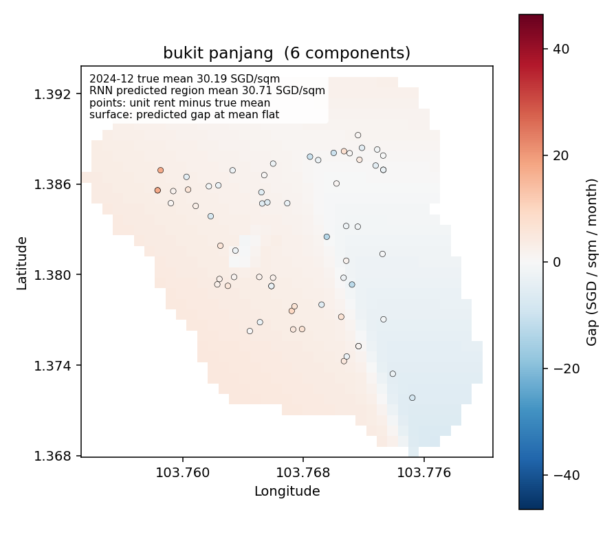

The compilable paper is `Docs/report/report.tex`. Compile it with pdfLaTeX from `Docs/report/`.

# Work summary

Training approvals run from January 2021 through March 2025. The test window is later. The scored model is a town-month unit-price mean, a within-town gap, and one shared network that turns those pieces into monthly rent. Search RMSE selects a stopped run. Confirm RMSE is recorded and does not choose a model.

## 0. Design idea

The target is a later month's rent, so a row in approval month T is not allowed to train on the true rents of months after T. The constraint is the same kind of constraint as a causal mask. The project does not train a transformer or an attention layer.

Two constructions enforce that rule in the feature table. The six group-mean columns use only training rents from the previous three approval months. `assert_past_only` in `src/features/build_features.py` checks that window. No other auxiliary column reads `MONTHLY_RENT`. January 2021 is null on those six columns because the three earlier months are not in the file.

The region model is a recurrent network, one per town. For the month being predicted it uses the time index and the economic trend already observed before that month. It does not receive that month's true rent, the previous month's predicted rent, or the true town-month rents of later months. Earlier economic inputs are carried by the hidden state. The sequence is started in 2021 so that state already exists when a later month is predicted.

The multistage prediction follows from that split of information. The recurrent network first traces the town's unit-price path, the large movement shared by flats in the same town. A flat's own location and attributes then explain how far its unit price sits from that path. A final network combines the path, that gap, and the flat's other numbers into one monthly rent.

## 1. Preprocessing the source columns

The raw files `Data/train.csv` and `Data/test.csv` are left unchanged. `src/features/source_fields.py` writes eleven derived columns into the auxiliary table. None of them reads `MONTHLY_RENT`. The same maps are applied to train and test.

Each column keeps the transform that matches its kind.

- `approval_month_index` is the number of months since January 2021. September 2024 is 44 and July 2026 is 66. `lease_commence_year` stays a four-digit year. It is not turned into a month index.
- `town_key`, `block_key`, and `street_key` strip, lowercase, and collapse spaces. They are names, not price ranks. Town and street have no natural price order. The feature `block_key` is the normalized block identifier only. The `BLOCK|STREET` key used to join the block table is a separate string and is not stored as this feature.
- `flat_type_ord` turns hyphens into spaces and maps 1-room through 5-room to 1 through 5 and executive to 6. Median floor area rises along that order, from about 31 square metres for 1-room to about 144 for executive. The rank is that size order. It is not fit on search or confirm rents.
- `flat_model_ord` is a fixed rank from 0 through 19, ordered from cheaper to dearer names observed in the training file. `flat_model_key` keeps the normalized name as a category. A tree can then split on a subset of names. The mixture and the numeric network receive only the rank. Training has 20 names. The test file has 19 of them and no name that is absent from training. `4-room` and `4 room` become the same type. Test streets such as `Whampoa Drive` match the lowercase training streets after this normalization.
- `floor_area_sqm` and `fee_amount` stay floats. They are not standardized on the whole table. `furnished_bin` is 1 for yes and 0 for no.

`FURNISHED` is yes on every train and test row, and `FEE` is 0 on every row. Those two fields do not vary.

## 2. Auxiliary features

`python -m src.features.build_features` writes 94 columns, in the same row order as the rental files, to `Data/auxiliary_features/train_features.csv` and `test_features.csv`. Training joins them back by that order. It does not sort. The six families are documented in `Docs/auxiliary_features/` and, with their construction figures, in `Docs/report/auxiliary_feature_summary.tex`. Those figures are named `images/*.png` and `outputs/figures/`; this workspace copy does not contain that image folder. The notes below follow the tex. The tex sentence that no model has yet been trained is older than the stack in section 3.

Block, distance, COE, and stock columns do not read `MONTHLY_RENT`. Distances are Haversine kilometres with Earth radius 6371.

### Block attributes

The block table is the hub. It has both an address and coordinates. The rental row is left-joined on

`block_key = norm(BLOCK) + "|" + norm(STREET)`,

where `norm` strips, lowercases, and collapses spaces, and letters inside `BLOCK` are kept. The key matches all 150,000 training rows and all 50,000 test rows, and the row count does not change. The copied fields are latitude, longitude, postal code (`NIL` becomes null), maximum floor, year of completion, subzone, planning area, and region. Building age is the approval year minus the completion year. Lease age uses `LEASE_COMMENCE_DATE` instead. A third column is the gap between those two years. A product of building age and a Central Region flag lets a linear model treat age differently in the centre. Town alone does not say whether the block is central, new, or tall, and the same completion year is a different age in 2021 and in 2026. Sentinel values of -1 on floor and completion year are stored as null (159 training rows, no test rows). `MAX_FLOOR` is the top floor of the block, not the flat's own floor.

### MRT, schools, and malls

The open trunk set is stations with status `open` whose code prefix is NS, NE, CC, DT, TE, EW, or CG. The two open Changi Airport (`CG`) stations are labelled EW. For each block the table stores the nearest trunk station's distance, code, normalized name, and line, the nearest station and distance on each of the six lines, and the number of trunk codes within 0.5, 1, and 2 km. Ties closer than `10^-6` km keep the lexicographically smallest code. Planned stations, and prefixes CR, JE, JS, JW, and CP, stay in their own distance columns so they cannot shrink the open-station distance. A flag is 1 when the nearest trunk station's name has at least two codes. The motivation is access: a flat near a station is easier to commute from, one distance cannot tell which corridor that station serves, and a count separates a single station from a cluster. The MRT file has no opening date, so a station marked open may have opened after January 2021. About 20 longitudes have only one to three decimal places. Great-circle distance is not walking time.

Primary schools are rows with `MAINLEVEL_CODE` equal to `primary` (179 schools). Secondary schools are the strings `secondary (s1-s5)` and `secondary (s1-s4)` (133 schools). Each set contributes a nearest distance, the normalized school name, and a count within 1 km. Primary schools also have a 2 km count. All 337 schools add one more nearest distance, name, and 1 km count. All 113 malls contribute the nearest distance, normalized name, and counts within 1 and 2 km. Names are kept because those tables have no code, and the normalized name is unique. Households pay for a short walk to a primary school or a shop, and a count distinguishes one neighbour from several. School and mall tables have no opening dates, and the school table has no university.

### Density and a fixed downtown point

The number of other HDB blocks within 500 m uses the same block coordinates and excludes the block itself. The town centroid is the mean latitude and longitude of blocks in that town, and each block is measured to its own centroid. Distance to the CBD is Haversine to the fixed Raffles Place coordinate `(1.283889, 103.851389)`, from station codes `ns26` and `ew14`. A log of the nearest trunk distance, `ln(d + 0.001)`, gives nearby changes more weight than a raw kilometre in a linear model. Two flats in the same town can still sit at the edge or next to downtown. These density features do not use rent. Cluster labels were not adopted: the official areas already exist, and clustering on rent would put the target into the features.

### COE and stocks

COE amounts are parsed by stripping dollar signs and commas. Each category-month uses bidding round 2, or round 1 if round 2 is absent. A rental in month T receives the premium, the change from T-2 to T-1, and bids divided by quota, all from month T-1. Categories A, B, and E have those three columns. Category A also has the mean of T-1, T-2, and T-3. Category C has only the lagged premium. Stock features use month-end adjusted closes. The bank basket is the equal-weight mean of `D05.SI`, `O39.SI`, and `U11.SI`. The property basket is `C09.SI`, `U14.SI`, and `9CI.SI`. A month is used only when all three symbols have a close. The rental again sees month T-1, both as a level and as that month's return. Dearer car quotas or weaker bank shares may coincide with tighter household budgets, which floor area and town cannot express. Both series are constant across flats approved in the same month. January 2021 COE lags are null because December 2020 is missing. The property basket is missing on early training rows because one constituent starts later. The four COE premiums are correlated about 0.93 with each other, so the region model later keeps one premium rather than all four.

### Group-mean rents

Six columns are target encodings: smoothed mean rent by postal sector, postal district, nearest mall, nearest open MRT code, nearest primary school, and nearest secondary school. For a row in month T, only training rents from T-1, T-2, and T-3 are used:

`smoothed = (n * group_mean + 20 * global_mean) / (n + 20)`.

`n` is the number of those training rows in the group, `group_mean` is their mean, and `global_mean` is the island-wide mean inside the same three months. If `n` is 0, the value is `global_mean`. February 2021 uses January only. Test rows never contribute rents. The sector and district strings are not stored. A mean accumulated since 2021 would still carry old rent levels into 2025, while the previous quarter moves with the market. Shrinkage keeps a thin quarter from being dominated by a few leases. The strength 20 is fixed. It was not tuned. A mall mean is the mean of rentals for which that mall is the nearest mall, not every flat inside a radius. Empty postal codes (285 blocks) have no postal-sector group and fall back to that quarter's island-wide mean once the window contains any training rent.

The month-by-group heatmaps described in the tex draw this formula even when that month has no rental in the group. A cell is blank only when the three-month window contains no training rents. The maps under `outputs/figures/maps/` place the same values on an OpenStreetMap background for each June and December whose window overlaps the training months. Each land cell takes the colour of its single nearest mall, primary school, or open MRT station, and each map has its own colour scale. The June 2025 MRT map uses March, April, and May 2025. The training file ends in March 2025, so that map's colours use March 2025 rents only.

## 3. The multistage model

The scored stack lives in `mean_residual_model/multi_stage_model(lstm+catboost+mlp)/`. Its test file is `outputs/predictions/mean_residual_multistage.csv`. The region mean, the town CatBoost, and the town mixture are fit through September 2024. Search is October through December 2024. Confirm is January through March 2025.

### Why the region is a town

A partition trial compared five regions, 26 towns, 31 planning areas, 24 postal districts, and 53 postal sectors as the geographic unit of a month mean. Town has no missing rows. Its town-month cells have a median of 110 fit-month rows, and 6% of those cells have fewer than 30 rows. Postal sectors have a median of 34 rows, 44% of cells are under 30, and 4,685 rows have no postal code. Town is fine enough that towns differ, and still large enough that a typical cell is not a handful of leases.

On the town-month mean of `MONTHLY_RENT`, a ridge of town indicators plus a month index has weighted cell RMSE 291.65 on October–December 2024 and 366.09 on January–March 2025. Adding `coe_c_premium_lag1` and `bank_basket_adj_close_lag1` lowers that to 94.37 and 112.85. Adding `property_basket_adj_close_lag1` lowers it further to 93.36 and 103.31. Using all 15 COE and stock columns scores 104.81 and 229.70, so the extra change, bid-ratio, and return columns make the next quarter worse. Month-to-month COE changes and bid ratios alone do not beat the month index. The adopted economy inputs for the region mean are therefore the month index and those three level series. A separate month slope for each town was worse (search cell RMSE 93.90, confirm 113.51 in the later town-month table).

### Region mean

The region model predicts the town-month mean of rent per square metre, `MONTHLY_RENT / floor_area_sqm`, with equal weight per flat. Each town has its own network. The input is the time index and the economic trend from before the month being predicted. The network does not see the true subsequent town-month rents. The hidden state carries the earlier economic inputs. Running the sequence from 2021 is required: a zero initial state would drop that history.

The network is `nn.RNN` with hidden size 16, three layers, and the default tanh, followed by `Linear(16, 1)`. It is trained for 50 epochs at learning rate 0.01 with seed 5228, on cells through September 2024. Search weighted cell RMSE is 0.9707 SGD per square metre. Confirm weighted cell RMSE is 1.0897. These are errors of the town-month unit-price mean, weighted by the number of flats in the cell. They are not the flat-level RMSE of monthly rent, and they are not mean squared error. They also cannot be compared with the dollar cell RMSE values in `logs/progress_1029.md`. A dollar cell error of about 90 SGD and a unit-price cell error of about 1 SGD per square metre are different targets.

Earlier dollar-mean trials are recorded in that log. Among them, a one-layer RNN had search cell RMSE 93.25 and confirm 88.04, and its unlabeled cross-town mean moved from 3192 in April 2025 to 3274 in July 2026. A four-input three-layer LSTM had search 88.75 and confirm 83.39, but its unlabeled path fell slightly, from 3132 to 3109. A linear bypass beside that LSTM fit the cells (fit-month cell RMSE 83.73) and then overshot: search cell RMSE 170.56, confirm 261.29, and an unlabeled path from 3339 to 3821. The per-square-metre three-layer RNN is the region mean used by the stack. On the same unit-price target, a linear-bypass LSTM scored 1.9646 and 3.4044. The RNN's unlabeled cross-town unit mean goes from 35.99 in April 2025 to 35.79 in July 2026. Confirm cell RMSE did not choose the network.

### Bukit Panjang map

The figure below is `src/viz/gaussian_towns/bukit_panjang.png`, drawn by `src/viz/plot_gaussian_towns.py` from the saved stack mixture. It is not the all-label refit. The title's six components are the number that town kept. The colour scale is shared across towns, symmetric about zero, at the 98th percentile of absolute values. A cell more than 400 m from a fit-month flat is blank. The figure was not chosen by RMSE.

The surface is the mixture's conditional per-square-metre gap, evaluated at that town's mean flat-type rank and mean flat-model rank. It is the predicted gap from the region mean, not the rent itself. December 2024 points are that month's unit rent minus Bukit Panjang's true December unit mean. The annotation states those two December means: the true mean is 30.19 SGD per square metre, and the RNN region mean is 30.71. A point and the cell under it do not use the same baseline. The point uses the true December mean. The surface uses the predicted gap from the region mean.

### Within-town gap

CatBoost and a Gaussian mixture are fit separately, one pair per town, to the same target: unit rent minus the RNN town-month unit mean. Neither model sees the other's output. CatBoost is used because the within-town columns include names and codes, and a tree can split on a subset of those names. The mixture is used because the remaining gap still varies smoothly with where the flat sits inside the town. Both are then turned back into a monthly-rent error by adding the gap to the RNN mean and multiplying by floor area.

On that rent scale, search RMSE is 455.06 for CatBoost and 490.02 for the mixture. Confirm RMSE is 469.19 and 502.48. On the unit-price scale the same predictions have search RMSE 5.3811 and 5.7707, and confirm RMSE 5.4562 and 5.8380. These numbers are in `residuals_metrics.json`. Confirm RMSE did not choose either model.

The town CatBoost uses depth 8, learning rate 0.05, at most 1000 iterations, and early stopping of 50 rounds on the search months. Its columns are fixed:

- latitude and longitude
- `block_key` and `street_key`
- `flat_type_ord`, `flat_model_ord`, and `flat_model_key`
- nearest open MRT code, distance, and log distance
- nearest mall name and distance
- nearest primary name and distance
- nearest secondary name and distance

Categories stay native. Numeric columns are median-imputed and not scaled. A rare level needs 30 rows. Unseen categories become a missing token.

### This feature list is not the ablation set

The town CatBoost was not built by the production ablation. The production pipeline, `python -m src.pipeline.run`, starts each model on the ten source columns. Ablation then probes auxiliary columns one at a time. For CatBoost a probe is promising only when its search RMSE is strictly lower than that round's set A. Set C, the current columns plus every promising column, replaces `best` only when its own search RMSE is lower. `finalize` retrains the columns already in `best` with a larger budget and does not add or drop columns. The columns that process kept are listed in `models/catboost/final/genome.json` (40 columns, including several line-specific station fields and five of the group-mean rents). That genome is a different model. It is not the feature list of the town stage above, and the stack does not replace `models/catboost/best` or `final`.

### Mixture assumptions

Each town's mixture is a full-covariance Gaussian mixture in five dimensions: latitude and longitude standardized inside the town, flat-type rank and flat-model rank standardized inside the town, and the per-square-metre residual. The residual is a coordinate. It is allowed to be negative, so a component can sit below the region mean as well as above it. The prediction is the responsibility-weighted conditional mean of that residual given the location and the two ranks. It is not a probability multiplied by the region mean. The component count starts at 20. If any component that is hard-assigned on the fit rows has fewer than 30 rows, the count drops by one and the town is refit, down to one component. Bukit Panjang kept 6. Across towns the kept counts in the scored fit run from 3 to 19.

An earlier location check, on a dollar gap rather than this five-dimensional unit-price mixture, is what was validated. Across 76 components, the fit-month dollar gap and the search-quarter gap correlate 0.890 (mean absolute error 69.1). An own-town three-dimensional surface starting at 3 components has search row RMSE 578.11 and confirm 593.19. A density blend across towns is worse, 579.76 and 594.42. Starting the own-town surface at 10, with the same drop rule, scores search 566.55 and confirm 580.58. Edge blends at 300 m and 500 m were worse than staying inside the town, and the saved surface file does not contain those edge scores. That correlation was not recomputed for the current per-square-metre mixture. The current mixture is scored by the rent RMSE in the previous subsection.

### The shared MLP

One network sees every town. It is not trained separately by town. The town-specific pieces it receives are the RNN mean, the CatBoost gap, and the mixture gap. The network is `Linear(27, 128)`, ReLU, dropout 0.1, `Linear(128, 64)`, ReLU, dropout 0.1, `Linear(64, 1)`. Optimization is Adam with learning rate 0.001 and batch size 1024. The target is monthly rent, z-scored on the fit rows and restored before the error is computed. The output is monthly rent. Area is not applied again after the network.

The 27 inputs are the RNN unit mean, the CatBoost unit gap, the mixture unit gap, and floor area, each as its own column; fee; lease commencement year; building age; month index; latitude and longitude after within-town standardization; raw latitude and longitude in degrees; flat-type rank; flat-model rank; maximum floor; year completed; flat age from the lease; distances to the nearest open MRT, mall, primary school, and secondary school; the log MRT distance; and counts of open MRT stations, malls, primary schools, and secondary schools within 1 km, plus other HDB blocks within 500 m.

Training runs for at most 100 epochs. After each epoch the search-quarter RMSE of monthly rent is computed. If that RMSE does not fall by more than `10^-6` for 10 consecutive epochs, training stops and the weights from the best search epoch are restored. Confirm RMSE is computed after that choice and does not enter it. The kept run stops at epoch 8. Search RMSE is 448.24. Confirm RMSE is 462.87. Train RMSE on the fit rows is 461.25. The CatBoost gap on those fit rows is the saved full model's prediction on its own fit rows, because the out-of-fold vectors were not stored. Search, confirm, and test CatBoost features are that same full model applied to those rows.

A wider network, widths 512-256-128-64, dropout 0.3, and patience 40, was tried on an earlier dollar LSTM mean. Its search RMSE was 448.88 and its confirm RMSE was 461.87 at epoch 29. It is not the stack prediction. That search RMSE belongs to a different region mean and is not a comparison with 448.24.

### Train, search, and confirm

Labeled months are cut in time. Confirm is the last three approval months, January through March 2025. Search is the three months immediately before that, October through December 2024. Fit is every earlier month, through September 2024. The preprocessor, the town coordinate scaling, and the mixture are fit on the fit months only.

Search is the only split that stops a model. CatBoost's iteration and the MLP's epoch are the ones with the lowest search RMSE under the patience rule. Confirm is a later quarter, kept so a report can say what happened after the choice, without letting that later quarter make the choice. The cut is by approval month, so the stopping decision cannot see leases from the confirm quarter.

## 4. Summary and limits

The adopted scored prediction is `outputs/predictions/mean_residual_multistage.csv`. It is the three-layer per-square-metre RNN, plus a per-town CatBoost gap and a per-town Gaussian mixture on that same unit residual, passed through one shared 128-64 MLP. Search RMSE of monthly rent is 448.24 at epoch 8. Confirm RMSE is 462.87 and did not choose the epoch.

An all-label refit, `python -m mean_residual_model.refit.run`, fits the same stack on every labeled month through March 2025. The RNN still trains for 50 epochs. Each town CatBoost keeps the iteration already chosen on the search quarter, with early stopping off. The MLP trains for 8 epochs. There is no search or confirm RMSE. The in-sample train RMSE on 150,000 labeled rows is 458.84, and that number did not choose the epoch. CatBoost and mixture features on those labeled rows are in-sample. Weights are under `mean_residual_model/refit/`. The test file is `outputs/predictions/mean_residual_multistage_refit.csv`. It does not replace the search-stopped file. The earlier ridge-mean files `outputs/predictions/mean_residual_<model>.csv` are a separate experiment and were not replaced either. Production `best` and `final` snapshots were not retrained on the eleven source-field columns.

Limits of this result:

- The RNN hidden state is bounded by tanh. Its unlabeled cross-town unit-price mean stays near 35.99 in April 2025 and 35.79 in July 2026. A linear bypass can keep a slope past the training range, and on the dollar town-month mean it overshot (search cell RMSE 170.56).
- Confirm RMSE never chose a model, an epoch, or a feature set. Quoting a confirm RMSE as the reason a model was kept would misstate the experiment.
- The CatBoost gap that the MLP sees on fit rows is an in-sample prediction of the full town model.
- Public HDB approved rents from April 2025 onward were used only as an external check of which dollar path looked plausible. They were not training labels. Among the dollar means, the one-layer RNN (3192 to 3274) was the closest to that external path (about 3179 to 3280). The downloaded check file was deleted.
- Fee does not vary, and furnished does not vary. Maximum floor is the block's top floor.
- A per-square-metre cell RMSE, such as 0.9707, is not comparable to a dollar cell RMSE, such as 88.75 or 93.25.
- The Bukit Panjang map is a picture of the conditional gap and of December 2024 flats. It was not scored, and it is not evidence that the mixture was selected.
- The component-gap correlation of 0.890 belongs to the earlier dollar location check. It was not recomputed on the five-dimensional per-square-metre mixture.
